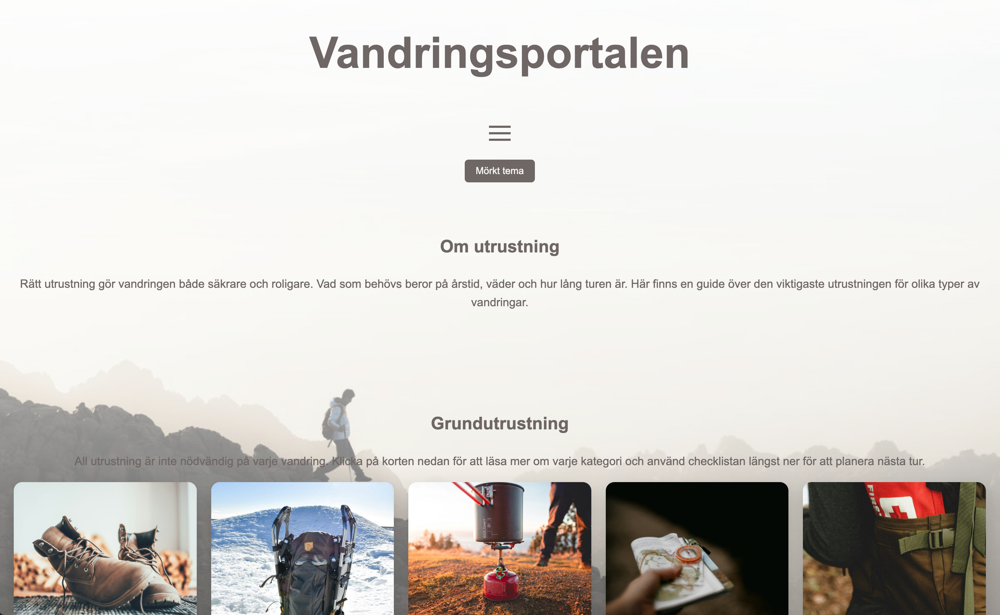

# Vandringsportalen – Explore Sweden's Hiking Trails
[🌐 View Live Website](https://sidneyroesch.github.io/vandringsportalen/)


A responsive hiking guide showcasing Sweden's beautiful hiking trails, national parks and outdoor destinations. Vandringsportalen aims to make it easier for outdoor enthusiasts to discover nature, explore destinations and find inspiration for their next adventure.

**Project status:** In development

## About the Project

Vandringsportalen is a frontend development project inspired by Sweden's diverse landscapes and outdoor lifestyle.

The goal is to create a clean, accessible and user-friendly platform where visitors can discover hiking destinations, explore trails and learn more about Sweden's natural environments.

The website combines a minimalist design approach with practical functionality and responsive layouts.

## Planned Features

- **Home page:** An introduction to Swedish hiking and outdoor experiences.
- **Hiking trails:** Explore hiking routes and destinations across Sweden.
- **National parks:** Discover Sweden's national parks and natural attractions.
- **Equipment guide:** Information about essential hiking equipment.
- **Responsive design:** Optimised layouts for desktop, tablet and mobile devices.
- **Interactive elements:** JavaScript-powered features to improve the user experience.
- **Navigation:** Clear and intuitive navigation between website sections.
- **Contact page:** A way for visitors to get in touch.

## Technologies Used

- **HTML5:** Semantic structure and accessible content.
- **CSS3:** Styling, responsive layouts, Flexbox and CSS Grid.
- **JavaScript:** Interactive functionality and dynamic user experiences.
- **Git & GitHub:** Version control and project management.
- **GitHub Pages:** Website hosting and deployment.

## Project Goals

The purpose of this project is to develop and demonstrate practical frontend development skills, including:

- Writing clean and semantic HTML.
- Creating responsive layouts using modern CSS techniques.
- Implementing interactive functionality with JavaScript.
- Improving accessibility and user experience.
- Organising and maintaining a structured frontend project.
- Using Git and GitHub for version control and project management.

## Project Structure

```text
vandringsportalen/
│
├── images/
├── index.html
├── utrustning.html
├── vandringsplatser.html
├── style.css
├── script.js
└── README.md
```

## Future Improvements

- Expand the hiking destination database.
- Introduce interactive maps and location information.
- Add more detailed hiking guides and trail information.
- Improve accessibility and user experience.
- Further develop JavaScript functionality.
- Optimise performance across different devices.

## Developer

**Sidney Roesch**

Frontend Development Student | Aspiring Frontend Developer

GitHub: [@sidneyroesch](https://github.com/sidneyroesch)

---

*Vandringsportalen – Discover Sweden, one trail at a time.*
